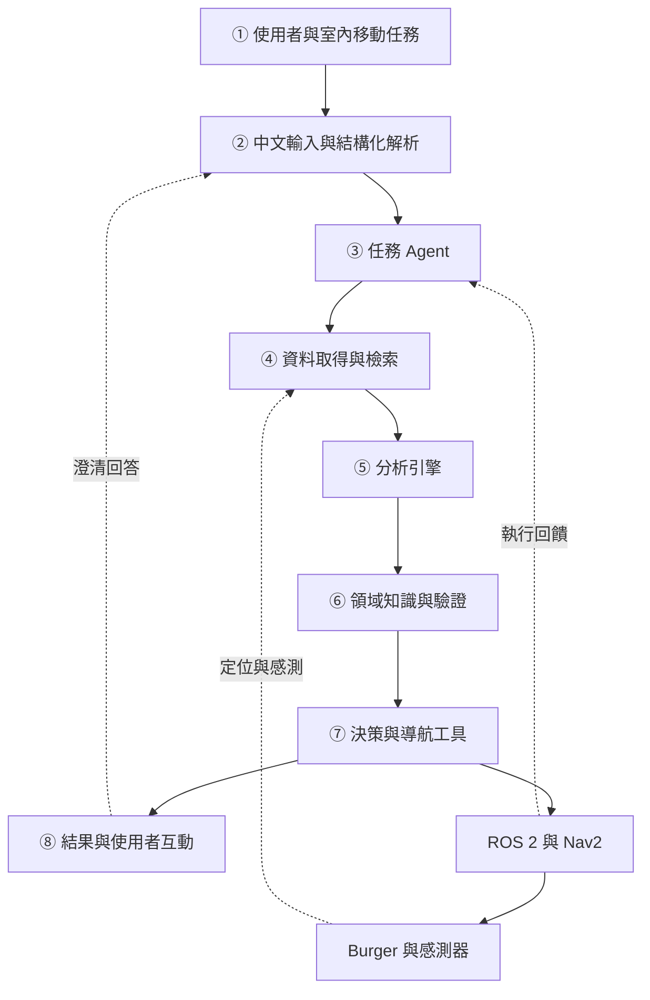

# Design

> 本文件由原始專題的 `source/DESIGN.md` 轉寫而來。動機見 `proposal.md`（Why），行為契約見 `specs/`，此處只說明「怎麼做」與「為什麼這樣選」。

## Context

- 原始 repo 只有離線原型：`src/agent_demo.py` 讀入預先準備的 JSON，以 mock 情境示範 `CLARIFY`、`NOT_READY`、`NO_PATH`、`FAILED`、`TIMEOUT`、`BUSY`、`CANCELED`，並有單元測試。尚未接 LLM、ROS 2／Nav2 或實機。
- 平台：單台 TurtleBot3 Burger、單一室內平面、預建 2D 地圖、人工命名地點。
- 限制：ROS 2／Nav2／Gazebo 版本須與實機核對後固定，不可混用 Humble／Jazzy 教學；LLM 供應者與 model ID 尚未選定。

## Goals / Non-Goals

**Goals:**
- 讓任務層（Agent）與導航層（Nav2）責任分離，使 Agent 的增益能在固定 Nav2 下被單獨量測。
- 每個決策都留下可核對的證據（工具呼叫、參數、時間、action 結果）。
- 離線 mock、模擬、實機三種後端共用同一套 Agent 與 gateway，只換 adapter。

**Non-Goals:**
- 不改進 Nav2 的規劃或控制演算法，不訓練 RL。
- 不做視覺物件辨識、取放、多車協調、長期地圖維護。
- 不使用向量資料庫；地點與規則檢索以 JSON 與關鍵字完成。

## Architecture



| 模組 | 對應 capability | 預計檔案 |
|---|---|---|
| ② 解析 | `task-intent-parsing` | `src/intent_parser.py` |
| ③ Agent／⑤ 分析 | 全部（流程協調） | `src/mission_manager.py` |
| ④ 資料 + ⑥ 驗證 | `robot-readiness`、`task-intent-parsing` | `config/landmarks.json`、`docs/domain_rules.md`、gateway |
| ⑦ 工具 | `navigation-dispatch` | `src/nav2_adapter.py`、gateway |
| ⑧ 回報 | `mission-reporting` | logger（JSONL） |

## Decisions

### D1：LLM 只輸出 intent + landmark_id，不輸出座標
- **選擇**：schema 只有四種 intent，座標由 registry 轉換。
- **替代方案**：讓 LLM 直接輸出 (x, y, yaw)。
- **理由**：座標不可被人工核對且可能落在牆內；白名單讓「不當派送」可被定義與量測（RQ1）。代價是無法去未登錄地點，以澄清／拒絕處理。

### D2：工具 gateway 白名單，而不是讓 LLM 呼叫 ROS API
- **選擇**：6 個工具，參數先經 schema 驗證，gateway 才呼叫 adapter。
- **替代方案**：類似 ROS-LLM 讓模型產生行為樹或程式 [14]。
- **理由**：本專題要評估可靠性，而非表達力；白名單把攻擊面與錯誤面縮到可測試範圍 [15]。

### D3：派送前 Readiness Gate 由規則判斷，不由 LLM 判斷
- **選擇**：`scan_age`、`pose_age`、`tf_ok`、`task_active` 以固定門檻檢查。
- **替代方案**：把狀態摘要丟給 LLM 判斷是否可出發。
- **理由**：門檻可重現、延遲低，也讓消融 B（移除狀態檢查）有清楚定義。

### D4：重試只在 Nav2 恢復行為結束後，且最多一次
- **選擇**：Agent 層 retry budget = 1，且重試前重新檢查狀態與路徑。
- **替代方案**：Agent 無限重試，或完全不重試。
- **理由**：避免與 Nav2 行為樹的 recovery 疊加成無限迴圈；一次重試足以涵蓋暫時性阻擋。

### D5：回報以 action 結果 + 觀測姿態為準
- **選擇**：`ARRIVED` 需 SUCCEEDED 且 final pose 在容許誤差內。
- **替代方案**：只看 action 狀態，或讓 LLM 依對話生成回報。
- **理由**：對應 RQ3；避免「輪子轉了但卡住」（D1 問題）造成誤報。

### D6：同一套 Agent 支援 mock／sim／real 三種 adapter
- **選擇**：`nav2_adapter` 介面固定，後端可替換。
- **理由**：先用 mock 跑單元測試，再在 Gazebo 跑 120 次比較，最後實機 36 次，Agent 程式不變，結果才能比較。

## Algorithm

```text
Algorithm 1  Evidence grounded indoor navigation agent
Input: query Q, landmark registry K, robot status S
Output: mission result R with evidence E
01: if Q is an explicit cancel command: cancel active goal; return status
02: reject a new movement request while another mission is active
03: read K and retrieve relevant domain rules with source IDs
04: parse Q into a schema constrained intent using the LLM
05: if parsing fails or the service times out: return clarification/error
06: if intent is ambiguous: ask user; return CLARIFY
07: validate tool name, landmark ID and schema against allowlists
08: if validation fails: return REJECTED without sending a goal
09: read scan, localization, TF and navigation lifecycle status
10: if data are stale or checks fail: return NOT_READY with evidence
11: resolve landmark ID into a registered pose in the map frame
12: request a path feasibility check with a bounded timeout
13: if no valid path: return NO_PATH; do not claim the goal is reached
14: send the validated goal through the navigation adapter
15: while mission deadline has not expired:
16:     read navigation feedback and fresh status; append evidence
17:     if user cancels or status is unsafe/stale:
18:         cancel goal; verify response; return CANCELED or FAULT
19:     if navigation result is SUCCEEDED:
20:         return ARRIVED with action result and observed final pose
21:     if navigation result is FAILED or CANCELED:
22:         if FAILED and retry budget remains and fresh checks pass:
23:             recheck path; retry once only when a valid path exists
24:         else: return the observed terminal result with evidence
25: cancel goal; verify cancellation or escalate unresolved state
26: return TIMEOUT with log IDs; never substitute an LLM guess
```

## Risks / Trade-offs

- [澄清與檢查增加互動延遲] → 分別量 parse／dispatch／report 延遲 p50/p95，在報告中與不當派送率一起呈現（RQ3）。
- [LLM 輸出不穩定] → 固定 model ID、版本日期、temperature、prompt hash；重複三輪另列，不當成獨立樣本。
- [2D LiDAR 看不到桌面等低矮／懸空物] → 實驗只使用掃描平面可見障礙物，並在限制中揭露。
- [模擬成功、實機失敗] → 模擬與實機結果分開報告；實機先挑 12 配對案例，操作員可隨時中止並記為安全中止。
- [示範座標被誤用於實機] → `landmarks.json` 保留 `demo_only` 標記；實機前重新登錄並版本化。
- [取消請求被接受 ≠ 已停止] → 需觀測 action 終止與速度；無法確認時回報 `FAULT`。

## Migration Plan

1. 固定 ROS 2／Nav2 版本，在 Gazebo 建立導航基準（B0）。
2. 將離線 `validate_request` 升級為 gateway，接 mock adapter，現有單元測試必須持續通過。
3. 接 LLM 解析（B1），再加入澄清、狀態檢查與證據回報（B2）。
4. 鎖定測試集與 commit hash 後執行比較與消融；最後實機。
- **Rollback**：任一階段失敗時，退回上一階段的 adapter，Agent 介面不變。

## Open Questions

- LLM 供應者與 model ID（不影響 spec：只要能輸出結構化 JSON）。
- 時效門檻與終點容許誤差的具體數值（由 20 筆開發資料決定後鎖定）。
- 實機 LDS 型號（影響感測規格紀錄，不影響 spec）。
